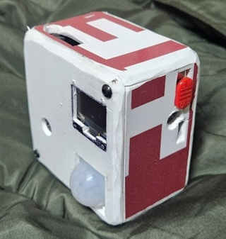
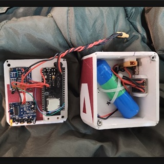

# 📸 ESP32-S3 IoT Autonomous Security Cube

Професійна автономна система відеофіксації та автоматизації безпеки, реалізована в компактному кастомному корпусі у вигляді куба. Пристрій побудовано на базі потужного мікроконтролера ESP32-S3 у середовищі розробки VS Code + PlatformIO з модульною архітектурою та низьким енергоспоживанням.

## 📷 Зовнішній вигляд пристрою

<p align="center" style="display: flex; justify-content: center; gap: 15px; flex-wrap: wrap;">
  
  
</p>

<p align="center">
  <em>Ліворуч: Готовий моноблок із виведеним PIR-датчиком та OLED-екраном. Праворуч: Внутрішнє компонування друкованої плати та відсік живлення з акумулятором Li-Ion.</em>
</p>


## 📐 Специфікація заліза та корпусу

Пристрій спроєктовано як моноблок із двома основними відсіками (модульна кришка з електронікою та силова частина корпусу):

* **Корпус:** Захищений кастомний куб із брендованими червоно-білими панелями. На фронтальну панель виведено лінзу PIR-датчика та OLED-дисплей. На бічній грані розміщено механічний перемикач живлення (ON/OFF).
* **Система живлення:** Автономна, на базі високострумового Li-Ion акумулятора (збірка 18650 / Li-Po), зафіксованого стяжками всередині корпусу. Для надійного з'єднання та швидкої зарядки використовуються силові роз'єми **XT30 / XT60**.
* **Електроніка:** Усі компоненти розведені на внутрішній друкованій платі-основі, що виключає обрив дротів при вібраціях або ударах.


## 🛠️ Архітектура системи та структура файлів

Проєкт має чітке розділення модулів. Веб-адмінка та стрімінг-сервер камери рознесені на різні порти та ізольовані у просторі імен, що повністю виключає конфлікти компілятора між бібліотеками `ESPAsyncWebServer` та `esp_http_server`.

```text
Мій_Проект/
├── lib/
│   ├── ConfigManager/         # Менеджер конфігурацій (Preferences, Web UI)
│   │   ├── ConfigManager.h    # Прототипи функцій запуска адмін-панелі
│   │   ├── ConfigManager.cpp  # Логіка сервера (Порт 81) та JSON API ендпоінти
│   │   └── UiHtml.h           # Енергоощадний Dark UI інтерфейс (HTML/CSS/JS)
│   ├── DisplayManager/        # Модуль керування OLED-екраном та іконками
│   │   ├── DisplayManager.h
│   │   └── DisplayManager.cpp
│   ├── CloudManager/          # Модуль HTTPS клієнта для вивантаження фото
│   │   ├── CloudManager.h
│   │   └── CloudManager.cpp
│   ├── LoggerManager/         # Ізольований глобальний статичний циклічний логер
│   │   ├── LoggerManager.h
│   │   └── LoggerManager.cpp
│   └── TFmodel_inferencing/   # Згенерована C++ бібліотека нейромережі Edge Impulse
├── src/
│   ├── global_config.h        # Глобальні змінні конфігурацій системи
│   ├── camera_pins.h          # Апаратна розпіновка матриці камери
│   ├── camera_server.h        # Обробник сервера камери та RAW ендпоінту (Порт 80)
│   ├── CameraConfig.h         # Апаратне налаштування OV2640 та виділення буферів у PSRAM
│   ├── CameraProcessor.h      # Математика ресайзу, кропу та локального запуску ШІ
│   └── main.cpp               # Логіка: ініціалізація периферії, дебаунс PIR та серійні плани Loop
└── platformio.ini             # Конфігурація залежностей та прапорців збірки

```

---

## 🚀 Реалізований функціонал

### 1.  Енергоощадність та Перформанс

* **Глобальний логер (LoggerManager):** Логи системи пишуться в ізольований статичний буфер char sys_logs[20][80] у пам'яті за мікросекунди без фрагментації heap-зони, дублюючи вивід у реальний Serial.
* **On-Demand Телеметрія:**  Плата збирає системні метрики (RAM, PSRAM, Wi-Fi RSSI, Uptime) та логи суто за JSON-запитом від браузера. Коли вкладка адмінки закрита — процесор і радіомодуль відпочивають.

### 2.  Конфігурація та Безпека

* **Панель керування (Порт 81):** Працює на базі ESPAsyncWebServer. Вхід захищено за допомогою HTTP Basic Auth. Дозволяє змінювати Wi-Fi, яскравість камери, логін/пароль та шлюз безпосередньо з вебу.
* **Автономний Dark UI:** Інтерфейс повністю зашито у флеш-пам'ять пристрою (UiHtml.h). Адмінка миттєво завантажується в браузері навіть у режимі локальної точки доступу (AP) без інтернету.

### 3.  Моніторинг та Шлюз Автоматизації (n8n)

* **Стрімінг-сервер (Порт 80):** Базується на низькорівневому драйвері esp_http_server.h. Видає чистий JPEG-кадр за запитом /photo.
* **Апаратна детекція руху:** PIR-датчик (GPIO 3) працює в режимі INPUT_PULLDOWN. При фіксації руху на OLED-екрані відображається статус, а пристрій виконує потокове надсилання сирих бінарних байтів JPEG (блоками по 1024 байти).
* **n8n Webhook Інтеграція:** Фотографії надсилаються асинхронно безпосередньо на ваш хмарний n8n шлюз автоматизації за протоколом HTTPS POST, звідки вони автоматично імпортуються у ваші робочі папки, месенджери чи диски.

### 4.  Локальний штучний інтелект (Edge AI / TinyML)

* **Вбудована нейромережа:** На чіпі розгорнуто квантовану згорткову нейромережу (Quantized 2D CNN int8), спроєктовану через Edge Impulse та оптимізовану під векторні інструкції ESP32-S3.
* **Локальне розпізнавання жестів:** Куб автономно виконує математичне виведення (Inference) за лічені мілісекунди, розпізнаючи класи empty (порожній фон), rock (камінь), scissors (ножиці) та paper (папір) з точністю до 95–97%.
* **Адаптивний фільтр упевненості:** Логіка обробки відсікає випадкові шуми за допомогою гнучкого фільтра (поріг упевненості 55% під специфіку int8 квантування), повністю виключаючи помилкові спрацьовування на порожню стіну.

---

## ⚡ Оптимізація та архітектурні рішення під залізо N16R8

Під час розгортання нейромережі система була повністю захищена від апаратних крашів та фрагментації пам'яті:
* **Статичне виділення пам'яті в PSRAM:** Великий кольоровий буфер розпакування графіки static_rgb_buf (640x480 * 2 байти) виділяється за допомогою функції heap_caps_malloc(..., MALLOC_CAP_SPIRAM) один єдиний раз під час запуску (setup), що повністю запобігло помилкам сервера 500 та витокам пам'яті.
* **Обхід обмеження стеку (Stack Overflow):** Важкі внутрішні об'єкти Edge Impulse SDK (signal_ai та result_ai) винесені з обмеженого 8 КБ стеку FreeRTOS безпосередньо у зовнішні 8 МБ PSRAM через макрос EXT_RAM_ATTR.
* **Захист від апаратного Watchdog (TG1WDT_SYS_RST):** Мільйони математичних згорткових операцій ядра TensorFlow Lite Micro надійно захищені від перезавантаження таймера процесора через примусове скидання таймауту за допомогою esp_task_wdt_reset() та мікропаузи vTaskDelay.
* **Апаратний Даунсемплінг:** Величезні кадри з високою роздільною здатністю (наприклад, UXGA) автоматично масштабуються драйвером у 4 рази (JPG_SCALE_4X) безпосередньо під час розпакування, вкладаючись у рамки буфера.
* **Серійна ШІ-зйомка:** Логіка main.cpp робить адаптивну серію з 3 послідовних кадрів з інтервалом у 300 мс після детекції PIR, даючи руці час чітко зафіксуватися по центру об'єктива.

## 🔌 Схема підключення периферії (Апаратні GPIO)

Конфігурація пінів жорстко зафіксована у файлі `camera_pins.h` та на друкованій платі пристрою:

* **OLED Дисплей SSD1306 (128x64 I2C, 400 кГц):**
  * `OLED_SDA` ➡️ `GPIO 2`
  * `OLED_SCL` ➡️ `GPIO 1`
* **Датчик руху (PIR Sensor):**
  * `PIR_PIN` ➡️ `GPIO 3`
* **Камера OV2640:**
  * `XCLK` ➡️ `GPIO 15`, `VSYNC` ➡️ `GPIO 6`, `PCLK` ➡️ `GPIO 13`, `HREF` ➡️ `GPIO 7`
  * `SIOD` ➡️ `GPIO 4`, `SIOC` ➡️ `GPIO 5`
  * `Data Bus` ➡️ `GPIO 11 (D2), 9 (D3), 8 (D4), 10 (D5), 12 (D6), 17 (D7), 18 (D8), 16 (D9)`

---

## 📊 Специфікація портів та ендпоінтів

| Компонент | Порт | Ендпоінт | Тип даних / Захист |
| :--- | :---: | :--- | :--- |
| **Web UI Admin** | `81` | `/` | Конфігуратор сторінки (**HTTP Basic Auth**) |
| **Telemetry API** | `81` | `/api/status` | Системні дані JSON (Uptime, Heap RAM, RSSI) |
| **Logs API** | `81` | `/api/logs` | Масив рядків JSON логів (Останні 20 подій) |
| **Camera Server** | `80` | `/photo` | Отримання поточного кадру JPEG (`image/jpeg`) |
| **n8n Webhook** | `443` | *Динамічний URL* | Сирий бінарний `POST`-запит із буфера камери |

---

## 📦 Залежності проєкту (`platformio.ini`)

```ini
[env:esp32-s3-devkitc-1]
platform = espressif32
board = esp32-s3-devkitc-1
framework = arduino
monitor_speed = 115200
build_flags = 
    -I src
lib_deps =
    adafruit/Adafruit GFX Library @ ^1.11.9
    adafruit/Adafruit SSD1306 @ ^2.5.9
    mathieucarbou/ESPAsyncWebServer @ ^3.2.4
```

> [!IMPORTANT]
> При першому вмиканні куба (або якщо Wi-Fi мережу не знайдено), пристрій створює власну точку доступу **`ESP32-S3-CAM-AP`**. Підключіться до неї з телефону та перейдіть за адресою `192.168.4.1:81`, щоб налаштувати параметри мережі та прописати ваш n8n Webhook URL.